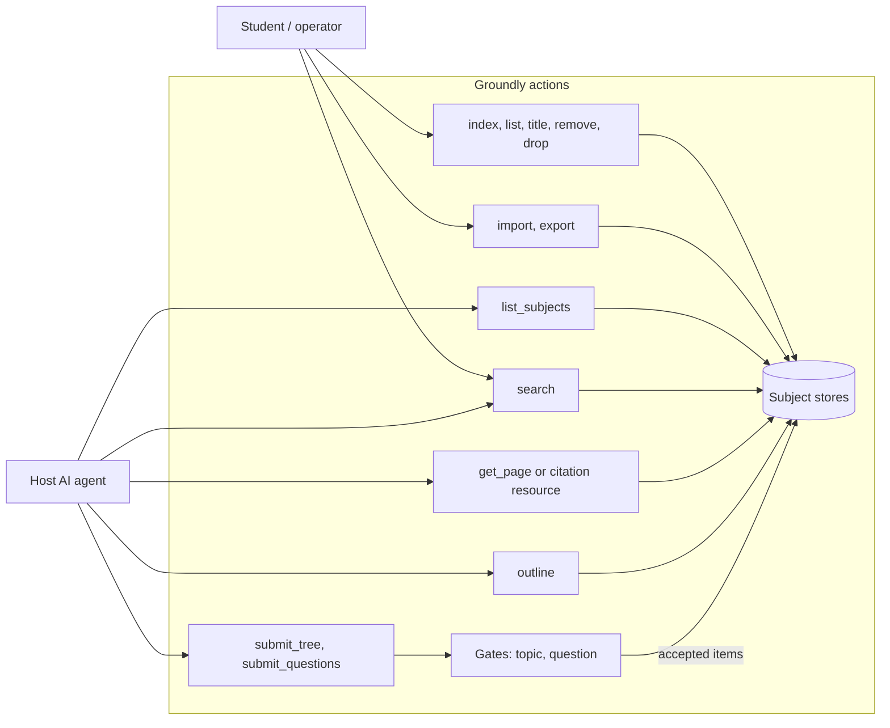

# Verification & Trust

Expands [`groundly-spec.md`](../groundly-spec.md) §5b. Governing rule: **Groundly verifies; the host generates.** An MCP host is already an LLM, so a second model behind the tool surface paid twice for the same capability (decision 33). What is left is two gates and one trust rule.

## Actors and actions

## The topic gate

`submit_tree` (`groundly/agents/topics.py`) is the first caller. The host sends titles, summaries and structure and **no citations**; Groundly chooses the sources.

1. **Structure first** (free, so the search is skipped when any fails): a non-empty tree; non-empty title and summary of valid text, title at most 200 and summary at most 500 characters; at most 1000 topics in all (`too_large`, reported alone); exactly two levels; every `id` exists in the current tree and appears once.
2. **Relevance**: each node, at both levels, is retrieved on `title + "\n" + summary` with the reranker always on, whatever `retrieval.rerank` says. The node passes if its top score is at least `TOPIC_RELEVANCE_CUTOFF = 1.0`; the hits at or above the cutoff, up to 5, become its sources.
3. **All or nothing**: a rejection lists every failing node, each with a machine-readable reason (`empty_tree`, `invalid_text`, `unknown_topic_id`, `duplicate_topic_id`, `too_deep`, `too_large`, `below_relevance_cutoff`). A `below_relevance_cutoff` entry also carries the top score and the nearest hit's filename, page and heading, so the host can reword. Nothing is written until every node has passed, and the write is one transaction: kept ids are updated, ids left out are deleted, nodes without an id get new ones, and all sources are replaced by the new search results (so a re-run also picks up new materials). The write can still fail after minutes of gate work, so the `submit_tree` tool names each cause as a tool error: the store is busy (an index run holds the write lock), a material was removed during the check, or a kept topic id was dropped by another submit (`StaleTopicError`, raised before anything is written); the host submits again.

A source cannot be invented or be a real-but-wrong slide, because the host never names one. **The gate shows a node's topic is in the course, not that its summary is true**: a false summary on a real topic is expected to pass, and nothing may call a summary verified or make it a citation target. Zero-key: only the local embedder and reranker, loaded lazily on the first node. A large tree is one slow tool call (the reranker scores each node in turn); splitting it into rounds across calls is the recorded fallback for hosts with short tool timeouts, not built.

`outline(subject)` is the read side: each indexed material with its page count and page headings, how many of its chunks the tree cites, and the current tree with ids. It is computed per call from existing columns, returns no chunk text or ids, and loads no model.

## The question gate

`submit_questions(subject, topic_id, questions)` (decision 44) judges each question on its own and stores those that pass; the rest come back by position with a machine-readable reason (`REJECTION_REASONS` in `agents/verifier.py`). A fault in the call itself (an unknown topic, a topic with subtopics, more than 50 questions) has no position and stores nothing. Checks run cheapest first, and no structural fault loads the embedder:

1. **Kind** — `single`, `multiple` or `open`. A question answered by writing code is refused at the door (`code_questions_unsupported`); a choice question may carry a `code` block to ask about code.
2. **Structure** — text lengths (stem 500, code 2000, option 300, reference answer 1000); a `single` has 2 to 6 options and exactly one correct, a `multiple` 3 to 8 with at least two correct and one wrong, an `open` a reference answer and no options; options are distinct; the stem is not already stored for the topic; the topic holds fewer than 200 questions.
3. **Citations resolve** — 1 to 5 chunk ids, each naming a chunk in this subject; unresolvable ids are named in the rejection. The `question_citations` FK enforces it a second time, and a question that loses its last citation is deleted by a trigger.
4. **Answerable by re-retrieval** — re-retrieving the stem, its code and the correct options (or the reference answer) must surface at least one cited chunk within `VERIFY_TOP_K` (20).

The write is one transaction that repeats the stem and limit checks under the write lock (`QuestionConflictError`, raised before anything is written): another session may have stored the same stem or filled the topic during the re-retrieval. That question is rejected with the same reason (`duplicate_question` or `bank_full`) and the rest are written, so two hosts filling one topic at once never store a stem twice or pass 200. As for a tree, a re-map that gave the topic subtopics or removed it meanwhile fails the write (`StaleTopicError`).

**The gate shows a question is well formed and about its cited chunks, not that its answer key is right**: that needs a model Groundly does not have, so nothing may call a key verified. The page may reveal a choice question's key before its test is submitted (decision 53's check route): that reads the stored key and writes nothing, and the answer counts only with the submitted attempt. A wrong question leaves the bank through `remove_questions`. Verification is **zero-key**: it touches only the local embedder.

A re-map cannot strand questions: `submit_tree` rejects, before any search, a tree that leaves out or subdivides a topic holding questions (`topic_has_questions`).

Subprocess execution of code answers is an idea, not planned (spec §3); until a runner exists, no question answered by writing code may be stored — the guarantee is unbuilt, not weakened.

## Trust layers

Fixed layers; lower never overrides higher:

| Layer | Content | Mutability |
|---|---|---|
| 1. System (immutable) | The rules in whatever prompt Groundly assembles | Code, versioned |
| 2. Task parameters | Subject, topic | Request-scoped |
| 3. Chunk text, imported KB content, user input | **Fully untrusted — data, never instructions** | Delimited, quoted, inert |

Titles and summaries a host submits, and the chunk text the topic page shows, are layer 3 too. The one prompt Groundly builds is a page run's (decision 46): a fixed template (layer 2) filled with the subject name and an integer topic id, with the flow's packaged skill as its system prompt (layer 1); course text reaches that run only through tools, as data. The subject name is an identifier from a strict character set, quoted, but an imported bundle may have chosen it. Mapping uses a fixed template carrying only the subject ID. Its private MCP session binds access to that subject and forces the first-map precondition at the topic gate (decision 55). A hostile PDF gets the same treatment as an imported bundle. The MCP server's `instructions` and tool descriptions are layer 1 product text, measured rather than improvised (decision 31).

## Observability

Nothing is traced. **`progress.db`** (personal, never exported) holds the student's submitted test attempts and their answers, and the host's verdicts and comments on written answers recorded through `review_answers` (decision 44); `search`, the topic tree and the question gate write nothing to it, and gate verdicts are not logged (decision 33).
