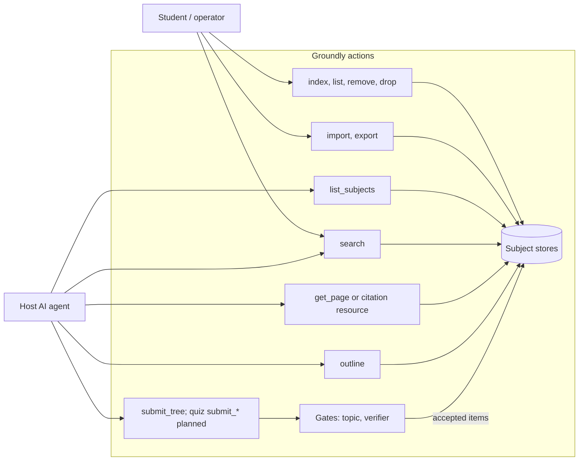

# Verification & Trust

Expands [`groundly-spec.md`](../groundly-spec.md) §5b. Governing rule: **Groundly verifies; the host generates.** An MCP host is already an LLM, so a second model behind the tool surface paid twice for the same capability (decision 33). What is left is two gates and one trust rule.

## Actors and actions

## The topic gate

`submit_tree` (`groundly/agents/topics.py`) is the first caller. The host sends titles, summaries and structure and **no citations**; Groundly chooses the sources.

1. **Structure first** (free, so the search is skipped when any fails): a non-empty tree; non-empty title and summary of valid text, title at most 200 and summary at most 500 characters; at most 1000 topics in all (`too_large`, reported alone); exactly two levels; every `id` exists in the current tree and appears once.
2. **Relevance**: each node, at both levels, is retrieved on `title + "\n" + summary` with the reranker always on, whatever `retrieval.rerank` says. The node passes if its top score is at least `TOPIC_RELEVANCE_CUTOFF = 1.0` (provisional until checked on real subjects); the hits at or above the cutoff, up to 5, become its sources.
3. **All or nothing**: a rejection lists every failing node, each with a machine-readable reason (`empty_tree`, `invalid_text`, `unknown_topic_id`, `duplicate_topic_id`, `too_deep`, `too_large`, `below_relevance_cutoff`). A `below_relevance_cutoff` entry also carries the top score and the nearest hit's filename, page and heading, so the host can reword. Nothing is written until every node has passed, and the write is one transaction: kept ids are updated, ids left out are deleted, nodes without an id get new ones, and all sources are replaced by the new search results (so a re-run also picks up new materials).

A source cannot be invented or be a real-but-wrong slide, because the host never names one. **The gate shows a node's topic is in the course, not that its summary is true**: a false summary on a real topic is expected to pass, and nothing may call a summary verified or make it a citation target. Zero-key: only the local embedder and reranker, loaded lazily on the first node. A large tree is one slow tool call (the reranker scores each node in turn); splitting it into rounds across calls is the recorded fallback for hosts with short tool timeouts, not built.

`outline(subject)` is the read side: each indexed material with its page count and page headings, how many of its chunks the tree cites, and the current tree with ids. It is computed per call from existing columns, returns no chunk text or ids, and loads no model.

## The verifier gate

Every generated quiz item entering `store.db` passes, in fail-fast order (no tool calls it until verified quizzes, sub-project 3):

1. **Citations present** — an item with no `chunk_ids` is rejected.
2. **Citations resolve** — each id must name a chunk in this subject; unresolvable ids are named in the rejection; the quiz tables (sub-project 3) will enforce it a second time with an FK.
3. **Answerable by re-retrieval** — re-retrieving the item's own text must surface at least one cited chunk within `VERIFY_TOP_K`.

Rejections are machine-readable (`REJECTION_REASONS`), so a host regenerates conversationally without a human in the loop. Verification is **zero-key**: it touches only the local embedder.

Planned: structural answer-key and distractor checks for MCQs (sub-project 3). Subprocess execution of code answers is an idea, not planned (spec §3); until a runner exists, no code question may be stored — the guarantee is unbuilt, not weakened.

## Trust layers

Fixed layers; lower never overrides higher:

| Layer | Content | Mutability |
|---|---|---|
| 1. System (immutable) | The rules in whatever prompt Groundly assembles | Code, versioned |
| 2. Task parameters | Subject, topic | Request-scoped |
| 3. Chunk text, imported KB content, user input | **Fully untrusted — data, never instructions** | Delimited, quoted, inert |

Titles and summaries a host submits, and the chunk text the topic page shows, are layer 3 too. Groundly assembles no prompts today (decision 37). If it ever does, the chunk text they carry is layer 3 — a hostile PDF gets the same treatment as an imported bundle. The MCP server's `instructions` and tool descriptions are layer 1 product text, measured rather than improvised (decision 31).

## Observability

Nothing is traced. **`progress.db`** (personal, never exported) holds no tables yet: `search` is read-only, and verifier verdicts are no longer logged (decision 33). Study progress arrives with verified quizzes (sub-project 3); the topic tree records none.
