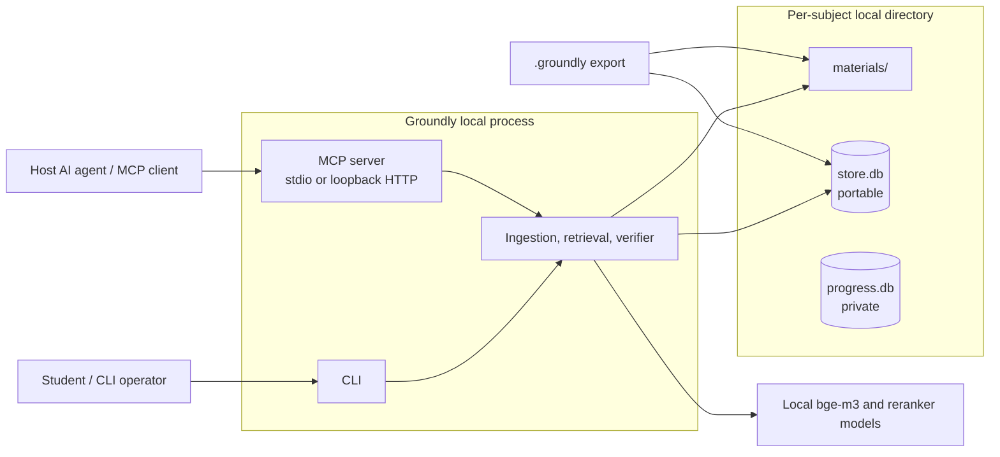

# Architecture Overview

Expands [`groundly-spec.md`](../groundly-spec.md) §4. Companions: [`data-model.md`](data-model.md), [`retrieval.md`](retrieval.md), [`agents.md`](agents.md), [`../infrastructure/distribution.md`](../infrastructure/distribution.md).

## Shape: one package, core with thin clients

There is no server to deploy. The product is a local **core library** with two clients over it. In MCP's stdio transport the "server" is a subcommand *spawned by the host agent* — there is no daemon for the student to manage.

```
groundly/
├── cli/         # typer verbs: index, list, remove, drop, search, import, export,
│             #   config, models, mcp (stdio, or --http)
├── mcp/         # FastMCP tool definitions over the core (stdio + streamable HTTP)
├── agents/      # the verifier gate — nothing unverified enters store.db
├── retrieval/   # dense + sparse + BM25, RRF fusion, cross-encoder rerank
├── ingestion/   # docling subprocess → HybridChunker → embed → stores
├── llm/         # local models: bge-m3 embedder + reranker, lazy-loaded (no LLM client)
└── core/        # store access (SQLite WAL), manifest, subject registry, settings;
                 #   bundle export/import (.zip)
```

### Module dependency rules

- **clients → services → foundations**, one direction: `cli`/`mcp` call `agents`/`retrieval`/`ingestion`; those call only `llm`/`core`. **Nothing imports the client layer.** Enforced by the import-linter `layers` contract in `pyproject.toml` (`lint-imports`, run in CI).
- Model loading lives **only** in `llm/`. Groundly constructs no LLM client anywhere (decision 37).
- `agents` calls `retrieval` (the verifier re-retrieves). `retrieval` never calls `agents`.
- `ingestion` writes the stores; it never serves queries.

## System context



Everything needs only the local models: no path reaches a provider, and none needs a key (decision 37).

## Runtime modes & concurrency

| Mode | Process | Lifecycle |
|---|---|---|
| CLI verbs | `groundly index/search/import/export/...` | one-shot, core in-process, exits |
| MCP stdio | `groundly mcp` | **spawned and killed by the host agent** |
| Optional HTTP | `groundly mcp --http` | user-run; MCP over Streamable HTTP; binds **127.0.0.1 only**; exists so multiple hosts share one bge-m3 load |

Multiple processes may open the same `store.db` (an `index` run while a host-spawned MCP process answers). Rules: **WAL + busy_timeout** on every connection; **lazy model loading** (never at MCP spawn — hosts expect fast handshakes).

## Cross-cutting rules

- **Citations are structural**: retrieval returns chunk ids; the core resolves them to document/page (+ heading path). 
- **Subject scoping is filesystem layout** — a query physically cannot cross subjects.
- **The privacy boundary is a file**: `store.db` exports; `progress.db` never does.
- **The verifier gates every write of a generated item** (quiz questions, sub-project 3), whoever generated it.
- **The host composes answers.** Groundly returns cited chunks and verifies what comes back; it runs no answer-generation loop of its own (decision 33).
