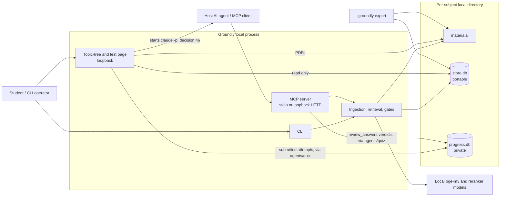

# Architecture Overview

Expands [`groundly-spec.md`](../groundly-spec.md) §4. Companions: [`data-model.md`](data-model.md), [`retrieval.md`](retrieval.md), [`agents.md`](agents.md), [`../infrastructure/distribution.md`](../infrastructure/distribution.md).

## Shape: one package, core with thin clients

There is no server to deploy. The product is a local **core library** with three clients over it (CLI, MCP server, local page). In MCP's stdio transport the "server" is a subcommand *spawned by the host agent* — there is no daemon for the student to manage.

```
groundly/
├── cli/         # typer verbs: index, list, title, remove, drop, search, import, export,
│             #   config, models, skill, mcp (stdio, or --http), serve, start
├── mcp/         # FastMCP tool definitions over the core (stdio + streamable HTTP)
├── web/         # Starlette app + one HTML file: the topic-tree and test page
├── agents/      # the gates — the topic gate (submit_tree) and the question gate (submit_questions); nothing unchecked enters store.db
├── retrieval/   # dense + sparse + BM25, RRF fusion, cross-encoder rerank
├── ingestion/   # docling subprocess → HybridChunker → embed → stores
├── llm/         # local models: bge-m3 embedder + reranker, lazy-loaded (no LLM client)
└── core/        # store access (SQLite WAL), manifest, subject registry, settings;
                 #   bundle export/import (.zip)
```

### Module dependency rules

- **clients → services → foundations**, one direction: `cli`/`mcp`/`web` call `agents`/`retrieval`/`ingestion`/`core` (`web` reads through `core` and writes an attempt through `agents/quiz.py`); those call only `llm`/`core`. **Nothing imports the client layer** except `groundly/__main__.py`, the `python -m groundly` entry point (a page run's stdio Groundly), placed above it in its own layer. Enforced by the import-linter `layers` contract in `pyproject.toml` (`lint-imports`, run in CI).
- Model loading lives **only** in `llm/`. Groundly constructs no LLM client anywhere (decision 37).
- `agents` calls `retrieval` (the question gate re-retrieves). `retrieval` never calls `agents`.
- Three writers touch `store.db`: `ingestion` (materials, chunks, vectors), the topic gate in `agents` (the tree, reached from `submit_tree`) and the question gate in `agents` (the question bank, written through the gate from `submit_questions`; `remove_questions` takes questions out). `ingestion` never serves queries; `web` writes no rows to `store.db` (a page run writes through the MCP gates in its own process, decision 46). It marks each source `pdf` only when the stored file resolves inside the materials dir, so the page never links a PDF an export left out.

## System context



Everything needs only the local models: no path of Groundly's reaches a provider, and none needs a key (decision 37). A page run is the student's own Claude Code, started by the page; it reaches the student's provider on the student's login, and Groundly only through MCP (decision 46).

## Runtime modes & concurrency

| Mode | Process | Lifecycle |
|---|---|---|
| CLI verbs | `groundly index/search/import/export/...` | one-shot, core in-process, exits |
| MCP stdio | `groundly mcp` | **spawned and killed by the host agent** |
| Optional HTTP | `groundly mcp --http` | user-run; MCP over Streamable HTTP; binds **127.0.0.1 only**; exists so multiple hosts share one bge-m3 load |
| Page + HTTP MCP | `groundly start` | user-run; one process, **127.0.0.1 only**, default 8765: the page at `/` and MCP over Streamable HTTP at `/mcp`, reachable as `groundly.localhost`; every host session shares one model load (decision 45) |
| Topic-tree page | `groundly serve` | user-run; Starlette on uvicorn, **127.0.0.1 only**, all subjects from one process, reads per request; **loads no model and writes no rows to `store.db`**; its one write is a submitted test attempt to `progress.db`, graded in `agents/quiz.py`; it may start one page run (below) |
| Page run | the student's `claude -p`, spawned by `serve` or `start` | at most one at a time, from a Write questions or Grade now click; ends with its result, **Stop**, a 20-minute timeout or the page process exiting; sees only Groundly's tools, reached at `/mcp` under `start` or through its own `groundly mcp` under `serve` (decision 46) |

Multiple processes may open the same `store.db` (an `index` run while a host-spawned MCP process answers). Rules: **WAL + busy_timeout** on every connection; **lazy model loading** (never at MCP spawn — hosts expect fast handshakes).

## Cross-cutting rules

- **Citations are structural**: retrieval returns chunk ids; the core resolves them to document/page (+ heading path). 
- **Subject scoping is filesystem layout** — a query physically cannot cross subjects.
- **The privacy boundary is a file**: `store.db` exports; `progress.db` never does.
- **A gate checks every write of host-generated content**: the topic gate for the tree, the question gate for questions, whoever generated it.
- **The page shows; it never decides.** Grading and mastery are `agents/quiz.py`'s, never the browser's, and a drawn test carries no key. Titles, summaries, questions and chunk text are layer 3 and are inserted as text only.
- **The host composes answers.** Groundly returns cited chunks and verifies what comes back; it runs no answer-generation loop of its own (decision 33).
- **The page may start the host, never be it.** A Write questions or Grade now click spawns the student's own Claude Code with Groundly's tools only and the init event checked fail-closed; Groundly passes it no key, no model and no layer-3 text, and the run writes through the same gates as a chat session (decision 46).
